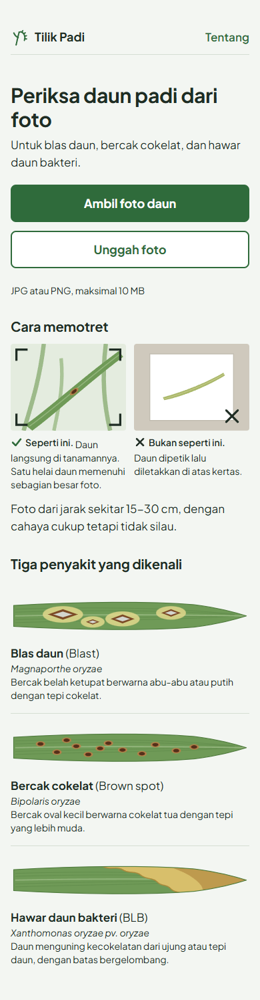
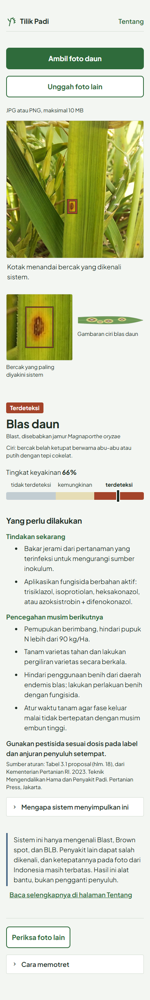
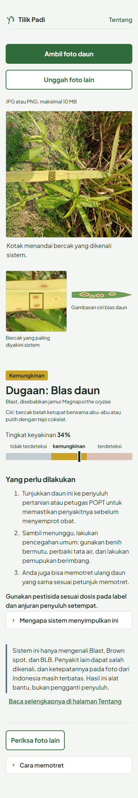
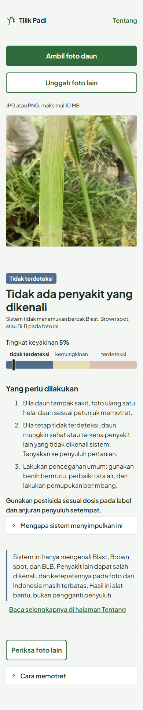
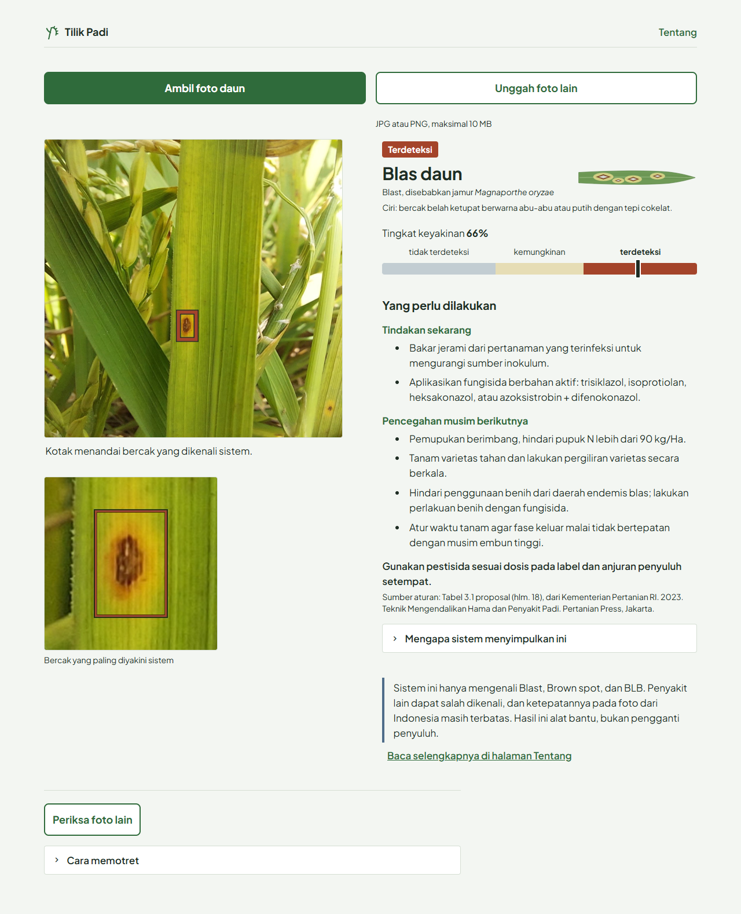

# Tilik Padi

Tilik berarti memeriksa dengan saksama.

Tilik Padi adalah aplikasi web (Streamlit) untuk mengenali tiga penyakit daun padi dari foto: blas daun (Blast), bercak cokelat (Brown spot), dan hawar
daun bakteri (BLB). Aplikasi memberi saran tindakan lewat sistem berbasis aturan (forward chaining). Dibuat untuk penelitian skripsi
di Universitas Telkom.

- Model: YOLO11s (`models/v7_deploy_yolo11s_s2.onnx`, model final aplikasi), dijalankan dengan ONNX Runtime di CPU.
- Diagnosis: kotak dengan tingkat keyakinan tertinggi. Tingkatnya: **terdeteksi** (≥ 35%), **kemungkinan** (29–35%), dan
  **tidak terdeteksi** (< 29%).
- Aturan: `rbs/rules.yaml`, berisi R001 Blast, R002 BLB, R003 Brown spot (kata-kata butir persis Tabel 3.1 proposal, Kementerian
  Pertanian RI 2023), serta aturan untuk tingkat kemungkinan dan tidak terdeteksi.

## Menjalankan

```powershell
cd <folder aplikasi>        # folder yang berisi streamlit_app.py
py -3.12 -m venv .venv
.venv\Scripts\python -m pip install -r requirements.txt
.venv\Scripts\streamlit run streamlit_app.py
```

Lalu buka http://localhost:8501. Rincian ada di `docs/menjalankan_lokal.md`, dan cara memasang online di `docs/deploy.md`.

## Struktur

| Folder/berkas | Isi |
|---|---|
| `streamlit_app.py` | tampilan saja (dua halaman: diagnosis dan Tentang) |
| `core/` | baca foto + koreksi EXIF, inferensi ONNX (letterbox, NMS), aturan tiga tingkat, gambar kotak, alur lengkap. Tanpa Streamlit |
| `rbs/` | `rules.yaml` dan mesin forward chaining (`mesin.py`). Tanpa Streamlit |
| `ui/` | potongan HTML (pita keyakinan, jejak aturan), ilustrasi SVG buatan sendiri (`ilustrasi.py`), dan `gaya.css` |
| `config.yaml` | jalur model, ambang, teks petunjuk memotret, atribusi data. Bisa diubah tanpa mengubah kode |
| `.streamlit/config.toml` | tema (palet, huruf Plus Jakarta Sans), batas unggah 10 MB, menu tersembunyi |
| `tests/` | 47 unit test + uji black-box |
| `tools/` | `uji_blackbox.py`, penggerak uji black-box (dipanggil `tests/test_blackbox.py`; butuh dataset proyek, dilewati di sini) |
| `docs/` | desain, arsitektur (Mermaid), hasil pengujian, tangkapan layar, panduan lokal dan deploy |

## Tangkapan layar

Ketiga tingkat jawaban (terdeteksi, kemungkinan, tidak terdeteksi), tampilan HP lebar 390 px:

| Halaman awal | Terdeteksi | Kemungkinan | Tidak terdeteksi |
|---|---|---|---|
|  |  |  |  |

Tampilan desktop (1280 px), hasil terdeteksi:



Foto di tangkapan layar berasal dari **RiceLeafDiseaseBD** (Munna dkk., 2026, Mendeley Data V3, doi:10.17632/86s4jzj2m4.3), lisensi
**CC BY 4.0**:
- `Blast/blast_104.jpg` (terdeteksi);
- `Blast/blast_1281.jpg` (kemungkinan);
- `Healthy/Healthy_1002.jpg` (tidak terdeteksi).

Foto ditampilkan bersama kotak dan potongan diperbesar yang dibuat aplikasi. Gambar daun dan petunjuk memotret di halaman awal adalah
ilustrasi buatan sendiri.

## Hasil pengujian

| Uji | Hasil | Berkas |
|---|---|---|
| Kesetaraan inferensi vs hasil evaluasi tersimpan (20 foto VAL) | kelas teratas identik 20/20; selisih keyakinan maks. 0,002 | `docs/uji_kesetaraan.md` |
| Unit test (setiap aturan dengan kata-kata persis Tabel 3.1, mesin termasuk tanpa aturan aktif, pembacaan foto, pra-/pasca-proses, ONNX, potongan diperbesar, CSS tanpa :has) | 47 lulus | `tests/` |
| Black-box (10 foto VAL acak per kelas + 4 skenario masukan) | 10/10 dan 4/4 sesuai harapan | `docs/uji/blackbox.md` |
| RAM | diam 145 MB; puncak 250 MB; 158 MB setelah 11 foto | `docs/uji/sumber_daya.md` |
| Waktu per foto (CPU laptop) | inti ±0,11 detik; ujung ke ujung di browser ±0,21 detik; foto 4000x3000 ±0,39 detik | `docs/uji/sumber_daya.md` |

Catatan: model aplikasi dilatih dengan train+val+test, jadi foto VAL termasuk data latihnya. Hasil black-box menguji perilaku sistem,
bukan ketepatan pada foto baru. Ketepatan pada foto dari Indonesia masih terbatas (lihat halaman Tentang).

## Atribusi

- Data latih:
  - RiceLeafDiseaseBD (Munna dkk., 2026, Mendeley Data V3, doi:10.17632/86s4jzj2m4.3), CC BY 4.0;
  - RICE Leaf Diseases (Kaggle yusufmurtaza01), lisensi metadata Kaggle: CC0-1.0;
  - Rice Leaf Disease Dataset (Kaggle soni535; berkas "Rice Leaf Bacterial and Fungal Disease Dataset", hanya foto daun sehat),
    lisensi metadata Kaggle: "unknown", ditulis sebagai "lisensi tidak dinyatakan oleh penyusun".
- Gambar daun dan petunjuk memotret di aplikasi adalah ilustrasi SVG buatan sendiri, bukan foto dataset.
- Model: Ultralytics YOLO11 (AGPL-3.0).

## Lisensi

Kode aplikasi dirilis dengan **GNU Affero General Public License v3.0** (`LICENSE`), mengikuti lisensi Ultralytics YOLO11 yang
menjadi dasar model. Data latih memiliki lisensinya masing-masing (lihat Atribusi).

## Perlu disamakan di dokumen skripsi: Tabel 3.1 proposal vs Tabel 3.2 BAB3_Metodologi.docx

Aplikasi memakai **Tabel 3.1 proposal** (hlm. 18; Kementerian Pertanian RI, 2023, *Teknik Mengendalikan Hama dan Penyakit Padi*,
Pertanian Press). `BAB3_Metodologi.docx` masih memuat versi lain sebagai **Tabel 3.2** (Kementerian Pertanian RI 2022; R003 dari
Semangun 2008). Di berkas itu, Tabel 3.1 adalah tabel pembagian dataset. Perbedaannya:

| Aturan | Tabel 3.2 BAB3 (2022) | Tabel 3.1 proposal (2023), dipakai aplikasi |
|---|---|---|
| R001 Blast | fungisida Tricyclazole atau Isoprothiolane; pangkas daun terinfeksi; perbaiki drainase; hindari N berlebih | pemupukan berimbang, N ≤ 90 kg/Ha; varietas tahan + pergiliran; hindari benih dari daerah endemis + perlakuan benih; atur waktu tanam; bakar jerami terinfeksi; fungisida trisiklazol, isoprotiolan, heksakonazol, atau azoksistrobin + difenokonazol |
| R002 BLB | bakterisida **Streptomisin**; drainase segera; hindari lahan tergenang; varietas tahan | varietas tahan; bersihkan tunggul dan jerami terinfeksi; seleksi dan perlakuan benih dengan agens hayati; kompos jerami terdekomposisi sempurna; agens hayati umur 14, 28, 42 HST; pupuk N sesuai takaran (**tanpa Streptomisin**) |
| R003 Brown spot | fungisida Mancozeb atau **Propiconazole**; tambah pupuk **kalium**; keseimbangan nutrisi | benih bermutu, tata air, pemupukan berimbang; sanitasi + pergiliran tanaman bukan inang; perlakuan benih air panas + fungisida; varietas tahan/toleran; fungisida difenokonazol, tebukonazol, heksakonazol, mankozeb, atau azoksistrobin + difenokonazol |
| R004–R006 | R004 Tungro; R005/R006 kombinasi dua penyakit | tidak dipakai (satu penyakit per foto; Tungro di luar cakupan) |

Yang perlu disamakan:
- nomor tabel;
- tahun dan judul sumber di daftar pustaka;
- isi butir di BAB 3 agar sama dengan aplikasi.
