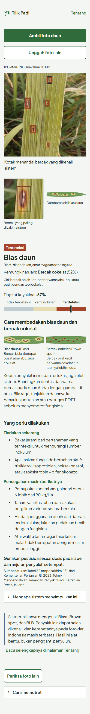
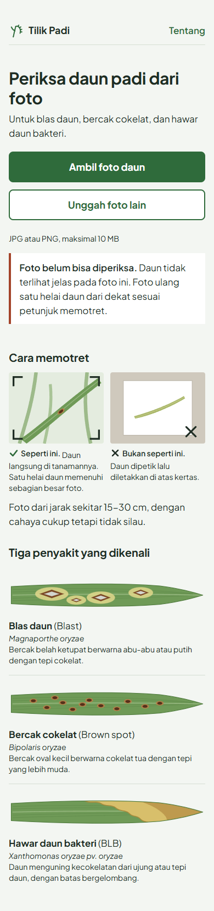
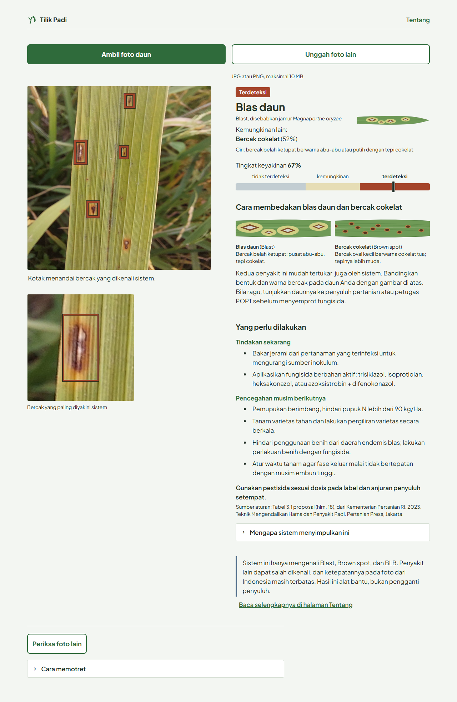
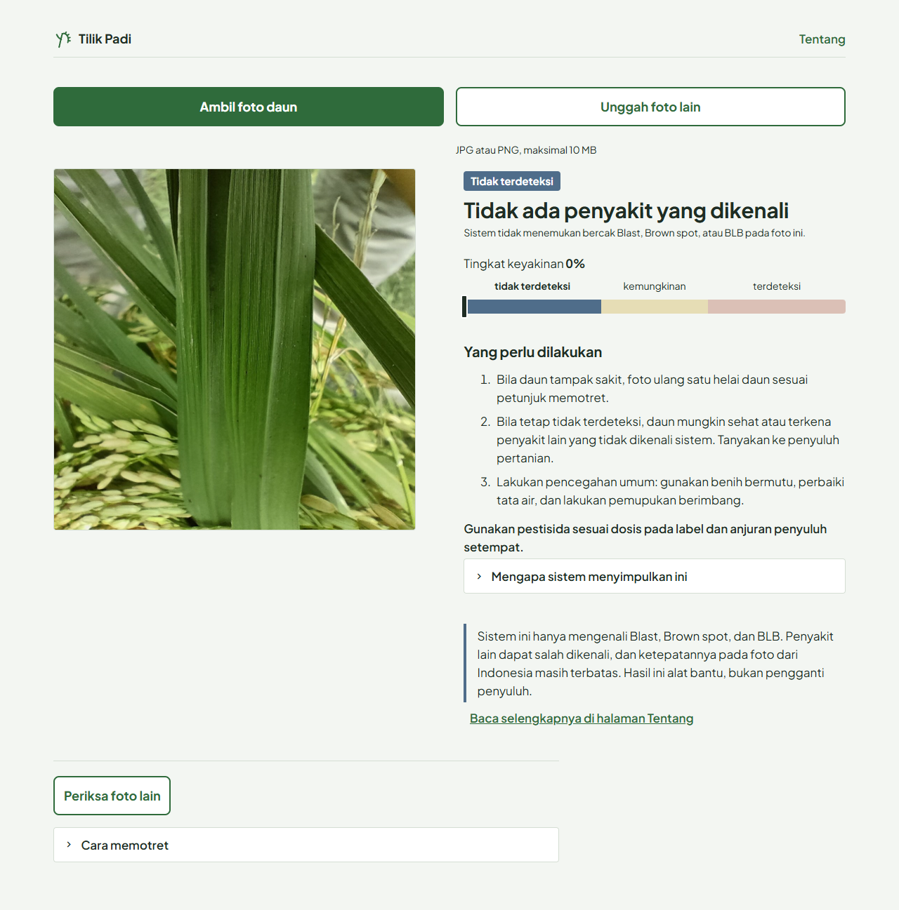

# Tilik Padi

Tilik berarti memeriksa dengan saksama.

Tilik Padi adalah aplikasi web (Streamlit) untuk mengenali tiga penyakit daun padi dari foto: blas daun (Blast), bercak cokelat (Brown spot), dan hawar
daun bakteri (BLB). Aplikasi memberi saran tindakan lewat sistem berbasis aturan (forward chaining). Dibuat untuk penelitian skripsi
di Universitas Telkom.

- Alur (sejak 2026-10-20, "alur v9"): dua model ONNX dijalankan dengan ONNX Runtime di CPU.
  1. **Pemisah daun** YOLOv8n-seg (`models/v9_pemisah_daun_yolov8n_seg.onnx`) mencari satu helai daun; latar di sekitarnya diganti
     abu, supaya penilaian hanya didasarkan pada daun.
  2. Bila tidak ada daun yang terlihat jelas, foto **tidak didiagnosis** dan pengguna diminta **memotret ulang**.
  3. **Detektor bercak** YOLOv8s (`models/v9_deploy_yolov8s_s2.onnx`, dilatih dengan foto berlatar abu) mencari bercak penyakit.
  YOLOv8 dipakai sesuai judul dan rumusan masalah skripsi; YOLO11 dilaporkan di skripsi sebagai pembanding.
- Diagnosis: kotak dengan tingkat keyakinan tertinggi. Ada **tiga tingkat jawaban**: **terdeteksi** (≥ 36%), **kemungkinan**
  (30–36%), dan **tidak terdeteksi** (< 30%). Kedua batas dikunci di data validasi sebelum pengujian.
- Aturan: `rbs/rules.yaml`, berisi R001 Blast, R002 BLB, R003 Brown spot (sumber: Kementerian Pertanian RI. 2023. Teknik
  Mengendalikan Hama dan Penyakit Padi. Pertanian Press, Jakarta; kata-kata butir persis Tabel 3.1 proposal), serta aturan untuk tingkat kemungkinan dan tidak terdeteksi.
- Penyampaian tambahan (tidak mengubah diagnosis, tingkat, atau saran):
  - **Kemungkinan lain**: bila ada bercak penyakit lain dengan keyakinan ≥ 30%, ditampilkan satu di bawah nama penyakit;
  - **Cara membedakan**: ilustrasi blas daun dan bercak cokelat berdampingan dengan cirinya, plus saran konfirmasi ke penyuluh.
    Tampil terbuka bila diagnosis utama dan kemungkinan lain adalah pasangan Blast dan Brown spot; terlipat bila Blast atau Brown spot
    muncul tanpa pasangan itu.

**Foto BLB dan daun yang dipegang tangan lebih sering diminta foto ulang.** Pada foto seperti itu, pemisah daun sering tidak menemukan
satu helai daun yang jelas. Dalam pengujian, 29,3% foto BLB diminta foto ulang (banyak foto BLB di data uji berupa daun dipegang tangan
atau dipotret sangat dekat), dan 17% foto daun petik dari Indonesia yang difoto di atas kertas. Hasil terbaik didapat dari foto daun
yang masih di tanamannya.

## Menjalankan

```powershell
cd <folder aplikasi>        # folder yang berisi streamlit_app.py
py -3.12 -m venv .venv
.venv\Scripts\python -m pip install -r requirements.txt
.venv\Scripts\streamlit run streamlit_app.py
```

Lalu buka http://localhost:8501. Rincian ada di `docs/menjalankan_lokal.md`, dan cara memasang online di `docs/deploy.md`.

## Struktur

| Folder/berkas | Isi |
|---|---|
| `streamlit_app.py` | tampilan saja (dua halaman: diagnosis dan Tentang) |
| `core/` | baca foto + koreksi EXIF, pemisah daun (`pemisah_daun.py`), inferensi ONNX (letterbox, NMS), aturan tingkat jawaban, gambar kotak, alur lengkap. Tanpa Streamlit |
| `rbs/` | `rules.yaml` dan mesin forward chaining (`mesin.py`). Tanpa Streamlit |
| `ui/` | potongan HTML (pita keyakinan, jejak aturan), ilustrasi SVG buatan sendiri (`ilustrasi.py`), dan `gaya.css` |
| `config.yaml` | jalur kedua model, ambang, pengaturan tampilan, teks petunjuk memotret dan pesan foto ulang, angka evaluasi untuk halaman Tentang, atribusi data. Bisa diubah tanpa mengubah kode |
| `.streamlit/config.toml` | tema (palet, huruf Plus Jakarta Sans), batas unggah 10 MB, menu tersembunyi |
| `tests/` | 78 unit test + uji black-box |
| `tools/` | `uji_blackbox.py`, penggerak uji black-box (dipanggil `tests/test_blackbox.py`; butuh dataset proyek, dilewati di sini) |
| `docs/` | desain, arsitektur (Mermaid), hasil pengujian, tangkapan layar, panduan lokal dan deploy |

## Tangkapan layar

Alur v9, tiga tingkat jawaban. Tampilan HP lebar 390 px:

| Halaman awal | Terdeteksi | Kemungkinan lain | Tidak terdeteksi |
|---|---|---|---|
|  |  |  |  |

| Tingkat kemungkinan | Diminta foto ulang |
|---|---|
|  |  |

Tampilan desktop (1280 px):

| Terdeteksi | Kemungkinan lain | Tidak terdeteksi |
|---|---|---|
|  |  |  |

Foto di tangkapan layar berasal dari **RiceLeafDiseaseBD** (Munna dkk., 2026, Mendeley Data V3, doi:10.17632/86s4jzj2m4.3), lisensi
**CC BY 4.0**:
- `Blast/blast_104.jpg` (terdeteksi; "Cara membedakan" terlipat);
- `Blast/blast_321.jpg` (terdeteksi Blas daun, kemungkinan lain Bercak cokelat; "Cara membedakan" terbuka);
- `Healthy/Healthy_1014.jpg` (daun sehat, tidak terdeteksi);
- `Blast/blast_414.jpg` (Blas daun, tingkat kemungkinan);
- `Healthy/Healthy_1432.jpg` (diminta foto ulang; fotonya tidak ditampilkan aplikasi, hanya pesannya).

Foto ditampilkan bersama kotak dan potongan diperbesar yang dibuat aplikasi. Gambar daun dan petunjuk memotret di halaman awal adalah
ilustrasi buatan sendiri.

## Hasil evaluasi alur aplikasi

Angka apa adanya dari skripsi (`reports/v9_latar/aplikasi_v9/RINGKASAN_FASE4_5.md` di folder proyek). Setiap set uji dievaluasi
sekali, setelah ambang dikunci di data validasi. **Foto yang diminta foto ulang dihitung sebagai jawaban salah** dan tidak memberi
kotak pada mAP.

Model penelitian (dilatih tanpa foto uji), rata-rata 3 kali pelatihan; IK 95% bootstrap per kelompok foto:

| Set uji | Akurasi diagnosis | Akurasi pada foto yang didiagnosis | Recall Blast | mAP50-95 | Diminta foto ulang |
|---|---|---|---|---|---|
| Test utama (432 foto Blast, Brown spot, daun sehat) | 0,731 [0,656; 0,800] | 0,759 | 0,805 | 0,253 | 3,7% |
| Test sesi pemotretan lain (292 foto) | 0,689 [0,620; 0,759] | 0,709 | 0,904 | 0,235 | 2,7% |
| Test BLB (150 foto, terpisah) | 0,398 [0,264; 0,558] | 0,563 | - | 0,095 | 29,3% |

Dibanding versi sebelumnya tanpa pemisah daun (v7, YOLOv8s yang dilatih dengan foto asli), akurasi tidak berbeda bermakna pada test
utama (-0,020 [-0,064; 0,019]) dan test sesi lain (-0,002 [-0,041; 0,035]), tetapi jauh lebih rendah pada BLB (0,398 vs 0,687).
Dibanding pemisahan latar dengan SAM2 (yang terlalu berat untuk aplikasi), akurasi lebih rendah secara bermakna (-0,036 dan -0,022),
terutama karena foto yang diminta foto ulang.

Model yang dipakai aplikasi (dilatih dengan train+val+test, dibandingkan dengan model aplikasi v7; pembanding, bukan hasil utama):

| Set | Model aplikasi v9 | Model aplikasi v7 |
|---|---|---|
| Test sesi pemotretan lain (292 foto): akurasi | 0,764 (0,785 pada foto yang didiagnosis; 2,7% foto ulang) | 0,801 |
| Daun petik dari Indonesia di atas kertas (70 foto): akurasi | 0,529 (0,638 pada foto yang didiagnosis; 17% foto ulang) | 0,471 |
| Daun Tungro (80 foto, di luar cakupan): disebut BLB | 68,8% (20% foto ulang) | 93,8% |

## Hasil pengujian perangkat lunak

| Uji | Hasil | Berkas |
|---|---|---|
| Kesetaraan detektor vs hasil Ultralytics (20 foto VAL v9) | tingkat jawaban sama 20/20; kelas teratas identik 18/20 (12/12 pada foto dengan keyakinan ≥ 0,01; 2 foto daun sehat dengan keyakinan ±0,003 bertukar urutan kotak yang hampir seri); selisih keyakinan maks. 0,0016 | `docs/uji_kesetaraan.md` |
| Kesetaraan pemisah daun vs masker yang dipakai di evaluasi (1.259 foto VAL) | keputusan foto ulang sama 1.255/1.259 (jumlah foto ulang sama: 86); IoU masker median 0,995, 97,8% ≥ 0,98 | `docs/uji/pemisah_daun.md` |
| Unit test (setiap aturan dengan kata-kata persis Tabel 3.1, mesin termasuk tanpa aturan aktif, pembacaan foto, pra-/pasca-proses, ONNX, pemisah daun dan foto ulang, potongan diperbesar, CSS tanpa :has, kemungkinan lain, cara membedakan) | 78 lulus (+ 1 test black-box) | `tests/` |
| Black-box: perilaku sistem (10 foto VAL acak per kelas + 4 skenario masukan + 6 skenario penyampaian) | perilaku sesuai 10/10, 4/4, dan 6/6 (hasil tampil; tingkat dan saran sesuai aturan; foto ulang diminta saat daun tidak jelas; masukan buruk ditolak). Kebenaran diagnosis tidak dinilai di sini, lihat "Hasil evaluasi alur aplikasi" | `docs/uji/blackbox.md` |
| RAM (Streamlit + kedua model) | diam 172 MB; puncak 273 MB; 191 MB setelah 11 foto | `docs/uji/sumber_daya.md` |
| Waktu per foto (CPU laptop) | inti ±0,22 detik; ujung ke ujung di browser ±0,33 detik; foto 4000x3000 ±0,60 detik | `docs/uji/sumber_daya.md` |

Pada kondisi mesin yang sama, alur v7 tanpa pemisah daun: RAM puncak 254 MB, inti ±0,13 detik, ujung ke ujung ±0,24 detik
(`docs/uji/sumber_daya_v7_ulang_20261020.md`).

Catatan: model aplikasi dilatih dengan train+val+test, jadi foto VAL termasuk data latihnya. Hasil black-box menguji perilaku sistem,
bukan ketepatan pada foto baru. Ketepatan pada foto dari Indonesia masih terbatas (lihat halaman Tentang).

## Atribusi

- Data latih:
  - RiceLeafDiseaseBD (Munna dkk., 2026, Mendeley Data V3, doi:10.17632/86s4jzj2m4.3), CC BY 4.0;
  - RICE Leaf Diseases (Kaggle yusufmurtaza01), lisensi metadata Kaggle: CC0-1.0;
  - Hasan, M., Khatun, S., Raihan, M. A., Uddin, A. H. (2023). Rice Leaf Bacterial and Fungal Disease Dataset. Mendeley Data, V2.
    doi:10.17632/hx6f852hw4.2, CC BY 4.0 (dicek di halaman Mendeley dan DataCite, 2026-10-30). Diakses melalui salinan Kaggle
    (soni535); hanya foto daun sehat yang dipakai.
- Gambar daun dan petunjuk memotret di aplikasi adalah ilustrasi SVG buatan sendiri, bukan foto dataset.
- Model: Ultralytics YOLOv8s dan YOLOv8n-seg (AGPL-3.0). Model pemisah daun YOLOv8n-seg dilatih meniru masker daun dari SAM 2
  (Meta AI, lisensi Apache-2.0).
- Sumber basis aturan: Kementerian Pertanian RI. 2023. Teknik Mengendalikan Hama dan Penyakit Padi. Pertanian Press, Jakarta.

## Lisensi

Kode aplikasi dirilis dengan **GNU Affero General Public License v3.0** (`LICENSE`), mengikuti lisensi Ultralytics YOLOv8 yang
menjadi dasar model. Data latih memiliki lisensinya masing-masing (lihat Atribusi).
