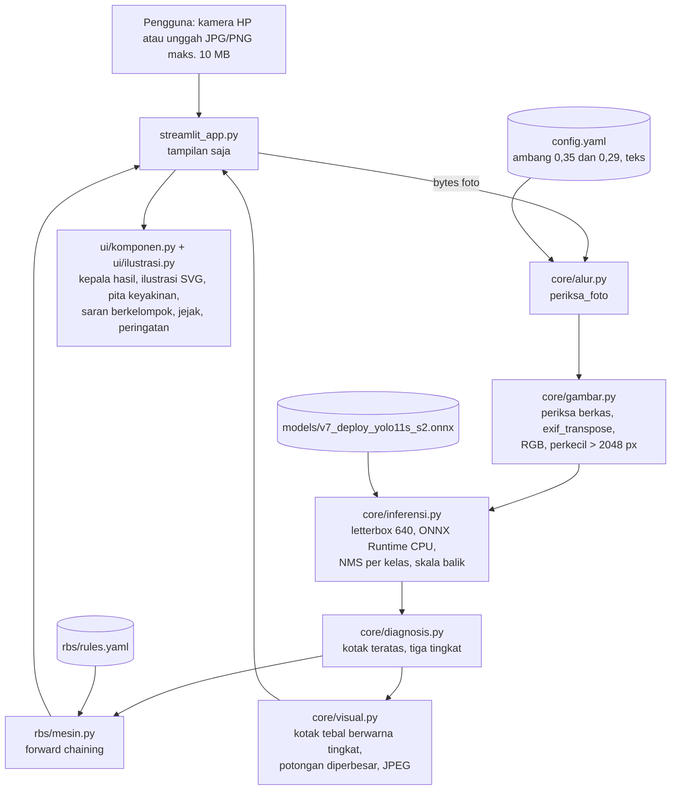
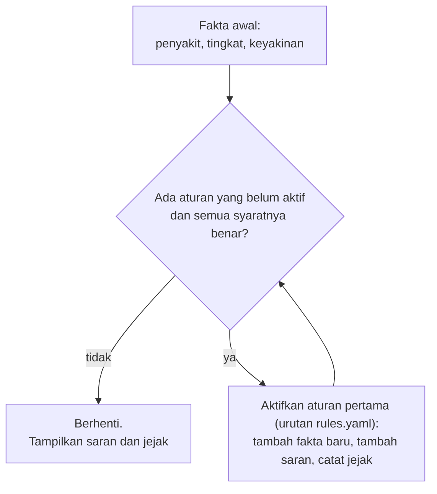

# Arsitektur

Tampilan (Streamlit) dipisahkan dari logika. `core/` dan `rbs/` tidak mengimpor Streamlit, sehingga bisa diuji dan dipakai ulang tanpa
antarmuka. `ui/komponen.py` hanya membuat string HTML.

## Alur forward chaining

Rantai yang terjadi (dua putaran, lalu berhenti):

| Tingkat | Putaran 1 | Fakta baru | Putaran 2 | Saran |
|---|---|---|---|---|
| terdeteksi | D01 Diagnosis diterima | `diagnosis = <penyakit>` | R001 / R002 / R003 | butir Tabel 3.1: tindakan sekarang [S] + pencegahan musim berikutnya [P] |
| kemungkinan | K01 Diagnosis belum pasti | `dugaan`, `perlu_konfirmasi = ya` | K02 | konfirmasi ke penyuluh + pencegahan umum |
| tidak terdeteksi | N01 Tidak ada penyakit yang dikenali | `perlu_foto_ulang = ya` | N02 | foto ulang + tanya penyuluh + pencegahan umum |

## Memori dan kecepatan

Diukur di folder proyek skripsi dengan Chrome headless (hasil: `docs/uji/sumber_daya.md`):
- RAM diam 145 MB, puncak 250 MB, dan 158 MB setelah 11 foto;
- waktu inti ±0,1 detik per foto di CPU laptop.

Penghemat memori:
- model dimuat sekali (`st.cache_resource`);
- arena memori ONNX Runtime dimatikan;
- foto > 2048 px didekode kecil;
- foto hasil dikirim sebagai JPEG.
