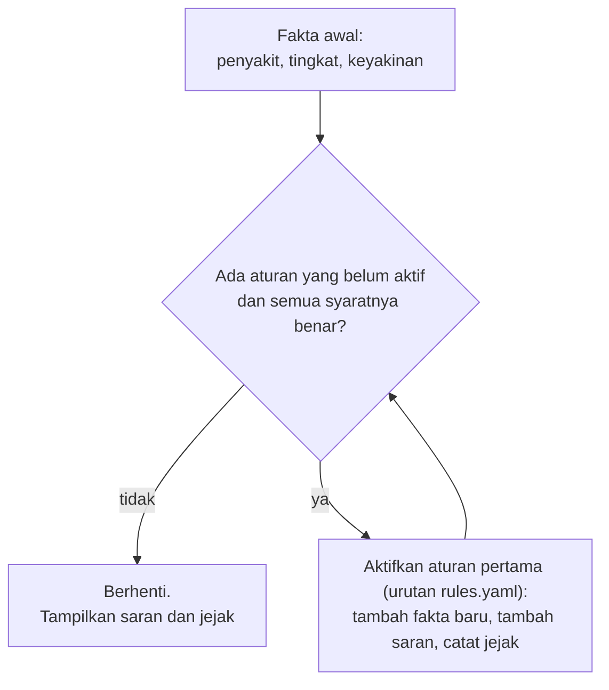

# Arsitektur

Tampilan (Streamlit) dipisahkan dari logika. `core/` dan `rbs/` tidak mengimpor Streamlit, sehingga bisa diuji dan dipakai ulang tanpa
antarmuka. `ui/komponen.py` hanya membuat string HTML.

```mermaid
flowchart TD
    U[Pengguna: kamera HP atau unggah JPG/PNG maks. 10 MB] --> S[streamlit_app.py<br/>tampilan saja]
    S -->|bytes foto| A[core/alur.py<br/>periksa_foto]
    A --> G[core/gambar.py<br/>periksa berkas, exif_transpose,<br/>RGB, perkecil > 2048 px]
    G --> P[core/pemisah_daun.py<br/>YOLOv8n-seg ONNX, pilih satu helai daun,<br/>latar diganti abu 114]
    MS[(models/v9_pemisah_daun_yolov8n_seg.onnx)] --> P
    P -->|tidak ada daun yang jelas| FU[FotoPerluDiulang:<br/>tidak didiagnosis, minta foto ulang]
    FU --> S
    P -->|foto berlatar abu| I[core/inferensi.py<br/>letterbox 640, ONNX Runtime CPU,<br/>NMS per kelas, skala balik]
    M[(models/v9_deploy_yolov8s_s2.onnx)] --> I
    C[(config.yaml<br/>ambang 0,36 / 0,30, tau 0,35,<br/>teks)] --> A
    I --> D[core/diagnosis.py<br/>kotak teratas, tiga tingkat,<br/>kemungkinan lain]
    D --> R[rbs/mesin.py<br/>forward chaining]
    RY[(rbs/rules.yaml)] --> R
    D --> V[core/visual.py<br/>kotak digambar di foto ASLI, warna tingkat,<br/>kotak putus-putus keyakinan rendah (nonaktif),<br/>potongan diperbesar, JPEG]
    R --> S
    V --> S
    S --> K[ui/komponen.py + ui/ilustrasi.py<br/>kepala hasil, kemungkinan lain, cara membedakan,<br/>ilustrasi SVG, pita keyakinan,<br/>saran berkelompok, jejak, peringatan]
```

## Pemisah daun (alur v9, sejak 2026-10-20)

Sebelum deteksi bercak, `core/pemisah_daun.py` menjalankan YOLOv8n-seg (distilasi masker SAM2 pada data latih v9) dan memilih satu
helai daun: instance dengan keyakinan >= 0,35, luas 3-95% foto, dan >= 50% piksel berwarna vegetasi; skornya akar luas x (0,2 +
cakupan kotak tengah 40%). Masker dirapikan (buang potongan kecil, tutup celah, isi lubang), lalu piksel di luar daun diganti abu 114
(sama dengan data latih model v9). Bila tidak ada daun yang memenuhi atau luasnya < 5% foto, alur melempar `gambar.FotoPerluDiulang`:
foto tidak didiagnosis dan pengguna diminta memotret ulang. Yang ditampilkan ke pengguna tetap foto aslinya beserta kotak bercak.

Kedua sesi ONNX Runtime memakai `session.intra_op.allow_spinning = 0`: tanpa itu, dua sesi yang dipanggil bergantian saling
memperlambat (prototipe: waktu inti ±400 ms, dengan pengaturan ini ±180-215 ms). Pasca-proses masker memakai `opencv-python-headless`.
Kesetaraan dengan masker yang dipakai di evaluasi skripsi: `docs/uji/pemisah_daun.md`.

## Penyampaian tambahan (tidak mengubah diagnosis, tingkat, atau saran)

| Fitur | Syarat (`core/diagnosis.py`) | Tampilan | Jejak |
|---|---|---|---|
| Kemungkinan lain | tingkat bukan "tidak terdeteksi"; ada kotak penyakit LAIN dengan keyakinan ≥ ambang rendah; satu, tertinggi | "Kemungkinan lain: <penyakit> (<keyakinan>%)" di bawah nama penyakit | fakta `kemungkinan_lain`, `keyakinan_kemungkinan_lain` + catatan tampilan |
| Cara membedakan | **terbuka** bila diagnosis utama dan kemungkinan lain adalah pasangan Blast dan Brown spot; **terlipat** bila Blast atau Brown spot muncul tanpa pasangan itu; tidak ada untuk BLB saja atau tidak terdeteksi | ilustrasi blas daun dan bercak cokelat berdampingan (ciri bab 2.2) + saran konfirmasi ke penyuluh; versi terlipat berjudul "Cara membedakan blas daun dan bercak cokelat" | - |

Tampilan "bercak berkeyakinan rendah" (kotak putus-putus pada hasil tidak terdeteksi) masih ada di kode, tetapi dinonaktifkan di
`config.yaml` (`tampilan.bercak_rendah_aktif: false`; KEPUTUSAN_PROYEK.md 2026-10-16).

Fakta tambahan ikut masuk memori kerja, tetapi tidak ada aturan di `rules.yaml` yang memakainya, sehingga rantai aturan dan saran sama
persis dengan tanpa fitur ini (diuji di `tests/test_inti.py`).

## Alur forward chaining



Rantai yang terjadi (dua putaran, lalu berhenti). Foto yang diminta foto ulang tidak masuk ke forward chaining:

| Tingkat | Putaran 1 | Fakta baru | Putaran 2 | Saran |
|---|---|---|---|---|
| terdeteksi | D01 Diagnosis diterima | `diagnosis = <penyakit>` | R001 / R002 / R003 | butir Tabel 3.1: tindakan sekarang [S] + pencegahan musim berikutnya [P] |
| kemungkinan | K01 Diagnosis belum pasti | `dugaan`, `perlu_konfirmasi = ya` | K02 | konfirmasi ke penyuluh + pencegahan umum |
| tidak terdeteksi | N01 Tidak ada penyakit yang dikenali | `perlu_foto_ulang = ya` | N02 | foto ulang + tanya penyuluh + pencegahan umum |

## Memori dan kecepatan

Diukur di folder proyek skripsi dengan Chrome headless (hasil: `docs/uji/sumber_daya.md`):
- RAM diam 172 MB, puncak 273 MB, dan 191 MB setelah 11 foto (kedua model dimuat);
- waktu inti ±0,22 detik per foto di CPU laptop (pemisah daun ±0,1 detik + detektor), ujung ke ujung di browser ±0,33 detik.

Penghemat memori:
- kedua model dimuat sekali (`st.cache_resource`);
- arena memori ONNX Runtime dimatikan;
- foto > 2048 px didekode kecil;
- foto hasil dikirim sebagai JPEG.
